# lean-sdd

**Two gates. Evidence for everything else.**

MIT license · Claude Code plugin · uses superpowers for TDD and debugging

lean-sdd runs a multi-step build in Claude Code: spec, plan, parallel build, review panel, merge.
You approve the spec and the merge. Claude asks about the rest in one batched round.

- Small tasks skip it: 1 to 3 files, no spec, no plan, no subagents.
- The plan lists interfaces and tests, not code.
- Each rule cites the failure behind it, or says it has none.

<picture>
  <source media="(prefers-color-scheme: dark)" srcset="assets/workflow-dark.svg">
  <source media="(prefers-color-scheme: light)" srcset="assets/workflow-light.svg">
  
</picture>

## Install

```bash
claude plugin install --marketplace alchristleo/lean-sdd lean-sdd
```

Inside a session, run `/plugin marketplace add alchristleo/lean-sdd`, then
`/plugin install lean-sdd@lean-sdd`.

Install superpowers first. lean-sdd does not pull it in.

| You need | When | How |
|---|---|---|
| superpowers | Always. TDD, debugging, finishing. | `claude plugin install superpowers@claude-plugins-official` |
| `gh` | Only at merge. | `gh auth login` |
| Status line | Only for the usage guard. | See [Usage guard](#usage-guard). |
| A browser tool | Only for `panel-cdo`. | Without one, the seat says QA was partial. |

Agents run as `lean-sdd:<name>`, for example `lean-sdd:sdd-implementer`.

## What happens to one task

Claude states the size first. Small means 1 to 3 files, under about 150 lines and no new
trust boundary. For a small task nothing happens, by design: it does the work directly.

Anything larger gets the full flow. Each task is built, reviewed and fixed at most twice. A task
that still fails is marked blocked, and the build moves on.

<picture>
  <source media="(prefers-color-scheme: dark)" srcset="assets/lifecycle-dark.svg">
  <source media="(prefers-color-scheme: light)" srcset="assets/lifecycle-light.svg">
  
</picture>

<details>
<summary>The coordinator reads short reports and never full diffs</summary>

<picture>
  <source media="(prefers-color-scheme: dark)" srcset="assets/sequence-dark.svg">
  <source media="(prefers-color-scheme: light)" srcset="assets/sequence-light.svg">
  
</picture>

</details>

<details>
<summary>The plugin ships two skills, ten agents, shell scripts and one hook</summary>

<picture>
  <source media="(prefers-color-scheme: dark)" srcset="assets/architecture-dark.svg">
  <source media="(prefers-color-scheme: light)" srcset="assets/architecture-light.svg">
  
</picture>

</details>

> [!IMPORTANT]
> Each gate needs an explicit yes. Answering an option question is not approval.

| You approve | Claude decides | Claude asks you |
|---|---|---|
| The spec | The plan and task split | Dismissing a review finding |
| The merge | Which agent builds each task | Skipping or folding a review step |
| | Fixes for findings two seats raise | Going past a fix-round cap |
| | Merge order of parallel work | Starting a task before its dependency |
| | | User-facing wording |

Claude also asks when a step is ambiguous and evidence cannot settle it. Source:
[`SKILL.md`](skills/lean-sdd/SKILL.md), the paragraph under the workflow diagram.

lean-sdd replaces the superpowers brainstorming, writing-plans and subagent-driven-development
skills. It still uses TDD, systematic-debugging and finishing-a-development-branch.

## Optional

- **Exec room.** CEO, CPO and CMO position papers before the spec. It runs only when you ask.
- **Ledger.** One line per event in the plan file, written by `scripts/sdd-log.sh`. It lets a
  build pause and resume.
- **Metrics.** `scripts/sdd-metrics.sh <plan>` prints tasks, fix rounds, blocked tasks and
  findings per seat. The retro pastes that line.
- **Commit trailers.** The hook that adds a trailer to subagent commits is off by default. Ask
  for commit trailers in the session or in the project's `CLAUDE.md`, and step 0 installs it.
- **Usage guard.** A hook pauses the build at 95% usage and prints `USAGE GUARD`.

### Usage guard

> [!WARNING]
> The guard does nothing without the status line. The hook reads a cache that
> `scripts/statusline-cache.py` writes.

Add this to `settings.json`. The command finds the newest installed version by itself.

```json
{
  "statusLine": {
    "type": "command",
    "command": "sh -c 'd=$(ls -d \"${CLAUDE_CONFIG_DIR:-$HOME/.claude}\"/plugins/cache/lean-sdd/lean-sdd/*/ 2>/dev/null | sort -V | tail -1); [ -n \"$d\" ] || exit 0; exec python3 \"${d}scripts/statusline-cache.py\"'"
  }
}
```

## Releasing

Maintainers: bump `version` in `.claude-plugin/plugin.json` on every user-visible change. Claude
Code uses it to detect updates, and the status-line command picks the highest installed version.

## Removed

Cut or lowered after reviews of real runs:

- The Medium size tier. 0 of 6 plans used it.
- Opus escalation after fix rounds. Two failed rounds now mean blocked.
- Opus by default for `panel-correctness`. It now runs on Sonnet unless a trust boundary exists.
- A 258-line `GUIDE.md`. This README replaces it.

## Proof

Four lines from [`CHANGELOG.md`](skills/lean-sdd/CHANGELOG.md). Each line names the failure that
caused the edit.

| Line | Edit | Failure behind it |
|---|---|---|
| [L27](skills/lean-sdd/CHANGELOG.md?plain=1#L27) | `panel-correctness` moved to Sonnet | It used 19% of 24h usage at Opus |
| [L35](skills/lean-sdd/CHANGELOG.md?plain=1#L35) | Docs claims cite a source | 8 fix rounds, 14+9 unsupported claims |
| [L73](skills/lean-sdd/CHANGELOG.md?plain=1#L73) | Medium tier dropped | 0 of 6 plans used it |
| [L85](skills/lean-sdd/CHANGELOG.md?plain=1#L85) | `sdd-log.sh` refuses newlines | A multi-line note forged a ledger line |

<details>
<summary>Six milestones in one repo, from 2 to 9 tasks each, none blocked</summary>

| Milestone | Tasks | Fix rounds | Blocked | Panel findings → triage |
|---|---|---|---|---|
| [hosted-cells](https://github.com/alchristleo/agentic-warden/blob/main/docs/superpowers/plans/2026-10-23-hosted-cells.md) | 6 | 2 | 0 | not logged |
| [platform-refresh](https://github.com/alchristleo/agentic-warden/blob/main/docs/superpowers/plans/2026-10-23-platform-refresh.md) | 5 | 2 | 0 | not logged |
| [docs-onboarding](https://github.com/alchristleo/agentic-warden/blob/main/docs/superpowers/plans/2026-10-24-docs-onboarding.md) | 9 | 6 | 0 | not logged |
| [readme-appeal](https://github.com/alchristleo/agentic-warden/blob/main/docs/superpowers/plans/2026-10-25-readme-appeal.md) | 6 | 3 | 0 | not logged |
| [releases](https://github.com/alchristleo/agentic-warden/blob/main/docs/superpowers/plans/2026-10-25-releases.md) | 2 | 1 | 0 | 13 fixed, 1 dismissed, 1 backlog |
| [security-hardening](https://github.com/alchristleo/agentic-warden/blob/main/docs/superpowers/plans/2026-10-25-security-hardening.md) | 8 | 1 | 0 | 4 fixed, 0 dismissed, 1 backlog |

6 milestones, one maintainer, one repo, Oct 2026. Descriptive, not a benchmark.

"Not logged": these ledgers predate the strict ledger format (`sdd-log.sh`), so panel triage was
not recorded in a countable form. Source: [`docs/field-notes.md`](docs/field-notes.md).

</details>

## How it compares

Yes, no or partial, read from each project's docs on 2026-10-26.

| Feature | lean-sdd | superpowers | spec-kit | Plain Claude Code |
|---|---|---|---|---|
| Size triage that skips small tasks | yes | partial | no | partial |
| Fixed approval gates | yes | partial | partial | partial |
| Acceptance criteria with a check command | yes | partial | partial | partial |
| Parallel build in isolated worktrees | yes | partial | partial | yes |
| Per-task review | yes | yes | no | partial |
| Multi-seat milestone panel | yes | no | no | partial |
| Spec converge, verdict per criterion | yes | no | partial | no |
| Usage guard | yes | no | no | partial |
| Retro that edits the workflow | yes | no | no | partial |
| Agents and editors | Claude Code | 16 entries | 43 entries | its own surfaces |
| Install | plugin command | plugin command | `uv tool install` | install script |
| Dependencies | superpowers, `gh` | not documented | Python 3.11+, uv | an account |

The per-cell quotes are in [`docs/comparison-research.md`](docs/comparison-research.md).
Sources, read 2026-10-26:
[superpowers](https://github.com/obra/superpowers),
[spec-kit](https://github.com/github/spec-kit),
[spec-kit docs](https://github.github.io/spec-kit/),
[Claude Code docs](https://code.claude.com/docs/en/best-practices).

### Trade-offs

1. It needs superpowers for TDD, debugging and finishing a branch.
2. It runs on Claude Code only. The other two list 16 and 43 agent entries.
3. The merge scripts need GitHub. They call `gh pr view` and `gh pr merge`.
4. One maintainer, since 2026-10-23. It is young.
5. Large work has two fixed human gates. Plain Claude Code has none.

## Where this came from

The rules come from real sessions in one public project,
[agentic-warden](https://github.com/alchristleo/agentic-warden). Milestone names in the changelog
refer to that repo. The spec, the plan and the exec-room papers for this release are in
[`docs/superpowers/`](docs/superpowers/) as a worked example of the workflow on itself.

## Built on

- [superpowers](https://github.com/obra/superpowers) by obra: TDD, systematic debugging and the
  finishing step.
- [archify](https://github.com/tt-a1i/archify) by tt-a1i: the diagrams.
- [asd-ste100](https://github.com/danyuchn/asd-ste100-skill) by Dustin Yuchen Teng: the bundled
  wording lint. See [`THIRD_PARTY_NOTICES.md`](THIRD_PARTY_NOTICES.md).
- [poteto](https://github.com/poteto/noodle): the reflect and meditate skills behind the retro.
- [Matt Pocock](https://github.com/mattpocock/skills): the retro and diagnosing-bugs ideas.

MIT license. See [`LICENSE`](LICENSE).
